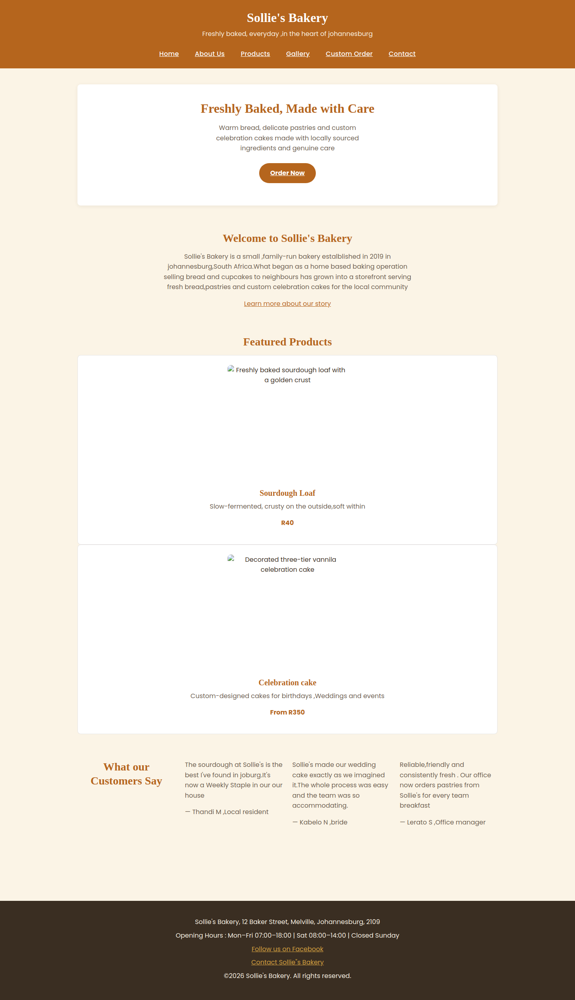
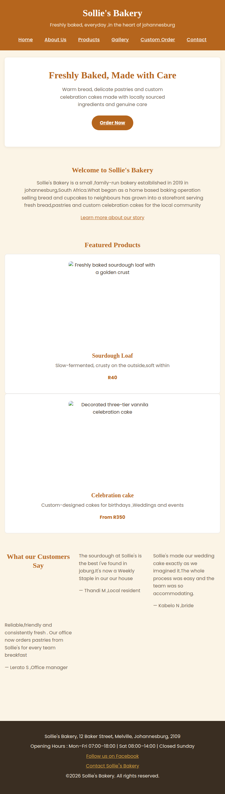
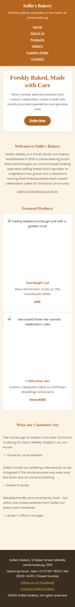

# Sollie's Bakery Website
 
## 🌐 Live Website
 
**Live site (GitHub Pages): <https://nhlayiseko.github.io/solliesbakery/>**
 
**GitHub repository: <https://github.com/Nhlayiseko/solliesbakery>**
 
---
 
## Student Information
 
| | |
|---|---|
| **Module** | Web Development (Introduction) — WEDE5020 |
| **Student Name** | Nhlayiseko Chauke |
| **Student Number** | ST10507277 |
| **Target Organisation** | Sollie's Bakery (Small Business – Baker) |
 
---
 
## Project Overview
 
Sollie's Bakery is a small, family-run bakery established in 2019 in Johannesburg, South Africa,
serving fresh bread, pastries and custom celebration cakes to the local community. The bakery
previously relied on a basic Facebook page and word-of-mouth referrals to reach customers.
 
This project delivers a professional, always-available website for Sollie's Bakery: a place to
showcase its story and products, list opening hours and locations clearly, and give customers an
easy way to enquire about custom cake orders or send a general message.
 
The project was delivered in three parts:
 
1. **Part 1 – Building the Foundation:** project proposal, planning, file structure and semantic
   HTML for all pages. *(Complete)*
2. **Part 2 – Designing the Visuals:** external CSS stylesheet, typography, colour, Flexbox/Grid
   layout, pseudo-class interactivity and responsive design. *(Complete)*
3. **Part 3 – Enhancing Functionality and SEO:** JavaScript interactivity, validated forms with AJAX
   submission, an interactive map, on-page and off-page SEO, and live deployment. *(Complete – this
   submission)*
---
 
## Website Goals and Objectives
 
- Increase local brand visibility and attract new customers searching online for bakeries near them.
- Generate leads and enquiries for custom orders (celebration cakes, catering, corporate gifting).
- Provide essential information quickly: menu, prices, location and opening hours.
**Key Performance Indicators (KPIs):**
 
- A minimum of 300 unique website visitors per month within the first three months.
- At least 15 custom order enquiries submitted via the enquiry and contact forms per month.
- An average session duration of two minutes or more, indicating genuine engagement with content.
---
 
## Pages and Features
 
| Page | File | Purpose | Part 3 features |
|---|---|---|---|
| Home | `index.html` | Hero banner, introduction, featured products, testimonials | Mobile menu, SEO tags |
| About Us | `about.html` | Story, mission and vision, values, team | Mobile menu, SEO tags |
| Menu | `products.html` | Bread, pastries and cakes with prices | **Live search and category filter**, SEO tags |
| Gallery | `gallery.html` | Photographs of cakes and daily bakes | **Lightbox image viewer**, SEO tags |
| Custom Order | `enquiry.html` | Custom cake and catering enquiry form | **Validated form with AJAX submission, FAQ accordion**, SEO tags |
| Contact | `contact.html` | Contact details, hours, two locations, message form | **Interactive Google Map, validated contact form that sends email**, SEO tags |
 
---
 
## Project Structure
 
```text
solliesbakery/
├── index.html
├── about.html
├── products.html
├── gallery.html
├── enquiry.html
├── contact.html
├── css/
│   └── style.css
├── js/
│   ├── main.js        (mobile menu + FAQ accordion, loaded on every page)
│   ├── gallery.js     (lightbox, gallery page only)
│   ├── search.js      (menu search and filter, products page only)
│   ├── map.js         (interactive map switcher, contact page only)
│   ├── enquiry.js     (enquiry form validation + AJAX, enquiry page only)
│   └── contact.js     (contact form validation + AJAX, contact page only)
├── images/            (product, team, gallery and map images)
├── docs/screenshots/  (evidence screenshots)
├── sitemap.md
└── README.md
```
 
All JavaScript lives in external `.js` files (no inline scripts). Each file checks that its page
contains the elements it needs and stops quietly if not, so one shared script tag pattern is safe
on every page.
 
---
 
## Setup and Running the Project Locally
 
1. Clone or download the repository:
```
   git clone https://github.com/Nhlayiseko/solliesbakery.git
```
2. Open the folder in Visual Studio Code.
3. Open `index.html` in a browser (or use the Live Server extension).
4. No installation, build step or framework is needed. The site is plain HTML, CSS and JavaScript.
**An internet connection is needed for:** Google Fonts, the embedded Google Map, and sending the
two forms (they send through Formspree).
 
**Form setup (only if you fork this project):** both forms submit with `fetch()` to a Formspree
endpoint set in the `action` attribute of the form tag in `enquiry.html` and `contact.html`.
Create a free form at formspree.io and replace the endpoint in both files with your own.
 
---
 
## Part 3 Details
 
### 1. JavaScript interactivity (`js/main.js`, `js/gallery.js`, `js/search.js`, `js/map.js`)
 
| Feature | File | How it works |
|---|---|---|
| **Mobile navigation menu** | `main.js` | On screens up to 600px wide a "Menu" button is created with JavaScript and the links open and close. The button updates `aria-expanded`. On desktop the menu is unchanged. |
| **FAQ accordion** | `main.js` | Four questions on the enquiry page. Clicking one opens its answer and closes the others. Works with Tab and Enter. |
| **Gallery lightbox** | `gallery.js` | Click (or press Enter on) a photo to enlarge it in an overlay with its caption. Close with the × button, the Esc key or a click outside. Previous/Next buttons and the left/right arrow keys move between photos. |
| **Menu search and filter** | `search.js` | A search box filters the 9 menu items as you type (every typed word must match). Category buttons (All, Bread, Pastries, Cakes) combine with the search. A status line shows "Showing X of 9 menu items" and a friendly message appears when nothing matches. |
| **Interactive map** | `map.js` | An embedded Google Map with drag and zoom. Two buttons switch the map between the Main Storefront and the Weekend Market Stall, and "Get directions" links open Google Maps. |
 
### 2. Forms: client-side validation and AJAX (`js/enquiry.js`, `js/contact.js`)
 
**Validation rules**
 
| Form | Field | Rule |
|---|---|---|
| Enquiry | Full name | Required, at least 2 characters, letters/spaces/hyphens/apostrophes only |
| Enquiry | Email | Required, valid email format |
| Enquiry | Phone | Optional, but if entered it must be a valid South African number |
| Enquiry | Order type | Required (a choice must be made) |
| Enquiry | Date needed | Required, and at least 5 working days ahead (matching the notice stated on the page); the date picker also blocks earlier dates |
| Enquiry | Servings | Required, a whole number from 1 to 500 |
| Enquiry | Tell us more | Optional, maximum 1000 characters |
| Contact | Full name | Required, at least 2 characters, letters/spaces/hyphens/apostrophes only |
| Contact | Email | Required, valid email format |
| Contact | Subject | Required, 3 to 100 characters |
| Contact | Message | Required, 10 to 1000 characters, with a live character counter |
 
**Behaviour (both forms)**
 
- Fields are checked when the visitor leaves them, and re-checked as they type once an error is showing.
- Error messages appear under the field with a red border, and are linked to the field with
  `aria-invalid` / `aria-describedby` for screen readers.
- On submit, every field is checked and the cursor moves to the first problem.
- **AJAX:** a valid form is sent in the background with `fetch()` (no page reload) to Formspree,
  which emails the submission to the bakery.
- The button changes to "Sending…" and is disabled while sending.
- A green success message thanks the visitor by name (with a "send another" button), or a red
  message explains what went wrong (server error or lost connection).
- A hidden "honeypot" field helps filter spam, and `novalidate` is set so the custom messages
  replace the browser's default pop-ups.
### 3. On-page SEO
 
**Keyword research.** Customers search locally ("bakery Johannesburg", "custom wedding cake
Melville"), so each page targets its own primary keyword to avoid the pages competing with each other.
 
| Page | Title tag | Primary keyword | Supporting keywords |
|---|---|---|---|
| Home | Sollie's Bakery \| Fresh Bread & Custom Cakes, Johannesburg | bakery in Johannesburg | fresh bread, custom cakes, Melville bakery |
| About | About Us \| Family-Run Bakery, Johannesburg \| Sollie's Bakery | family-run bakery Johannesburg | local bakery, community bakery, sourdough |
| Menu | Bakery Menu & Prices \| Bread, Pastries, Cakes \| Sollie's Bakery | bakery menu and prices | sourdough loaf, croissants, muffins, celebration cakes |
| Gallery | Custom Cake & Pastry Gallery \| Sollie's Bakery Johannesburg | custom cake gallery | wedding cakes, birthday cakes, pastries |
| Custom Order | Custom Cake Order & Catering Enquiry \| Sollie's Bakery Johannesburg | custom cake order Johannesburg | wedding cake quote, corporate catering |
| Contact | Contact & Opening Hours \| Sollie's Bakery, Melville Johannesburg | bakery contact and opening hours Melville | bakery location, weekend market stall |
 
**Implemented on all six pages**
 
- A unique, keyword-rich `<title>` of roughly 60 characters or fewer.
- A unique `meta description` of roughly 150 characters, written to read well in search results.
- A `meta keywords` tag with 5–8 relevant terms (kept short, with no keyword stuffing; included
  because the module rubric assesses it, although major search engines no longer use it for ranking).
- A canonical link to each page's live address.
- **Open Graph** tags (`og:title`, `og:description`, `og:url`, `og:image`, `og:image:alt`, `og:type`,
  `og:site_name`, `og:locale`) so links look good when shared on Facebook, WhatsApp and LinkedIn.
- **Twitter Card** tags (`summary_large_image` with title, description, image and image alt).
- **Heading hierarchy:** exactly one `<h1>` per page describing that page, followed by `<h2>` and
  `<h3>` in order (the products page was corrected from `h2 → h3 → h4` to `h1 → h2 → h3`). The
  header's site name became a styled paragraph so it no longer competes as an `h1`.
- **Images:** every `` has descriptive alt text, and the six gallery images were renamed from
  `gallery-01.jpg` – `gallery-06.jpg` to descriptive names such as
  `three-tier-wedding-cake-sugar-flowers.jpg`.
- Keywords added naturally to headings and page copy (for example "Fresh Bread, Pastries & Custom
  Cakes in Johannesburg").
### 4. Off-page SEO strategy
 
Off-page SEO means building the bakery's reputation and links on other websites. The strategy
below is a **plan for the bakery to carry out after launch**; none of it has been done yet.
 
1. **Google Business Profile.** Claim and complete a profile for both locations (storefront and
   weekend market stall) with the same name, address, phone number and hours as the website, plus
   photos. This is the single most valuable step for "near me" searches.
2. **Consistent local listings (citations).** List the bakery in South African directories such as
   Yellow Pages SA, Cylex and Hotfrog, keeping the name, address and phone number identical everywhere.
3. **Link from existing social profiles.** Add the website link to the Facebook page, and to any
   Instagram or WhatsApp Business profile, and post new cakes with a link back to the gallery.
4. **Local relevance and partnerships.** Ask nearby Melville businesses, the Sunday market
   organisers and event or wedding suppliers (venues, planners, florists) to link to the site, and
   offer to link back.
5. **Content other sites want to link to.** Local food bloggers, community newsletters and
   neighbourhood Facebook groups may feature seasonal cakes, a "meet the baker" story or a market
   announcement.
6. **Customer reviews.** Ask happy customers to leave Google reviews. Reviews build trust and help
   local ranking.
7. **Quality over quantity.** Prefer a few relevant local links over many low-quality ones, use
   natural link text (for example "custom wedding cakes in Melville"), and never buy links, since
   search engines penalise it.
8. **Measure.** Track visitors and enquiries (the KPIs above) and review which sources send them.
### 5. Deployment
 
The site is deployed with **GitHub Pages** from the `main` branch (root folder) and is live at the
link at the top of this file. Because GitHub Pages is case-sensitive, all file and folder names
are lowercase and match the links in the HTML. All pages, images, scripts, the embedded map and
both forms were tested on the live site as well as locally.
 
---
 
## Testing
 
Every feature was tested locally and then again on the live site (using a hard refresh to avoid cached files).
 
| Area | What was tested |
|---|---|
| Navigation | All 6 pages open from every page; mobile menu opens and closes; desktop menu unchanged |
| Accordion | Opens, closes, only one open at a time; keyboard (Tab, Enter) works |
| Lightbox | Opens from click and keyboard; close button, Esc and background click close it; Previous/Next and arrow keys; wraps from last to first; page does not scroll behind it; phone layout |
| Search and filter | Searches by name, description and price; multiple words; capital letters; category buttons combined with search; "no results" message; Clear button |
| Map | Loads, drags and zooms; both location buttons switch the map and caption; directions links open; phone layout |
| Enquiry form | Each field's error message; date picker limits; successful submission and email received; "send another"; offline failure message |
| Contact form | Each field's error message; character counter; successful submission and email received; offline failure message |
| SEO | Title, description, keywords and social tags checked with "View Source" on all pages; one `h1` per page confirmed in the browser console |
| Responsive design | Desktop, tablet and phone widths checked on each page |
| Console | No red errors on any page |
 
---
 
## Known Limitations
 
- The addresses, phone number and email on the site are placeholders created for this assignment,
  so the map pins are approximate and the contact details are not real.
- The forms depend on the third-party service Formspree. Its free plan has a monthly submission
  limit, and the form endpoint is visible in the page source (normal for this type of service).
- Client-side validation can be bypassed by a determined user, so a production website would also
  validate on a server.
- The embedded map needs an internet connection and relies on Google's embed service.
- The `meta keywords` tag is included for the assessment, but search engines such as Google no longer use it.
- Off-page SEO is a written strategy; its actions are for the bakery to carry out after launch.
---
 
## Screenshot Evidence
 
Part 2 evidence (homepage at three screen widths):
 
| Desktop (1440px) | Tablet (768px) | Mobile (375px) |
|---|---|---|
|  |  |  |
 
Part 3 evidence is provided in the Portfolio of Evidence document.
 
---
 
## Sitemap
 
See [`sitemap.md`](sitemap.md) for the full sitemap and page relationships.
 
---
 
## Changelog
 
### Part 1 – 2026-08-14
- Set up root project folder and `css/`, `js/`, `images/` subfolders.
- Added the Website Project Proposal document.
- Created six semantic HTML5 pages with a consistent navigation menu and footer.
- Added the custom order enquiry form and general contact form.
- **Result: 94/100.**
### Part 2 – 2026-09-15
- Created `css/style.css` and linked it from the `<head>` of all six pages.
- Added CSS variables for the colour palette and typography, a CSS reset, and base styles.
- Styled the header and navigation with Flexbox, including hover/focus/active states.
- Built the homepage hero, featured-products grid, and testimonials grid.
- Styled the About page's mission/vision columns, values list, and team member cards.
- Built the Products page's category headings and product-card grid.
- Styled the Enquiry page's form with a Grid layout and visible focus states.
- Styled the Contact page's hours table, locations, map placeholder, and contact form.
- Styled the footer consistently across all pages.
- Added tablet (900px) and mobile (600px) media queries for layout, typography, and navigation.
- Added Google Fonts (Playfair Display, Poppins) via both `@import` in the stylesheet and `<link>` tags.
- Fixed a testimonials-grid regression found during review.
- Captured desktop/tablet/mobile screenshots of the homepage as evidence.
- Documented outstanding HTML-side typos and casing mismatches in a Known Issues section.
- **Result: 100/100.**
### Part 3 –2026-11-02
 
#### A. Work done in response to Part 2 feedback
 
 
**Items from the Part 2 Known Issues table:**
 
| Issue recorded in Part 2 | Resolution |
|---|---|
| `<tittle>` misspelled on `about.html` | Corrected to a proper `<title>`, now also search-optimised |
| `id="featured-prdoucts"` on `index.html` | Corrected to `featured-products` so the product grid applies |
| `class="testimonials"` on each testimonial article | Corrected to `testimonial` so the card styling applies |
| `id="What-we-value"` capitalisation on `about.html` | Corrected to lowercase `what-we-value` so the values grid applies |
| `Sollie"s` straight-quote typo in the footer link | Corrected on all pages |
| Inconsistent `images/` and `Images/` folder casing | All paths are lowercase and the folder is `images/`, so images load on case-sensitive hosting |
| Google Fonts links missing on `products.html` | Added so all six pages are consistent |
 
**Additional fixes found while reviewing the HTML against the CSS:**
 
- **Hosting casing:** `Gallery.html` was renamed to lowercase `gallery.html` so the navigation link
  works on GitHub Pages. The `Images` folder was renamed to `images`.
- **About page:** the Mission and Vision were loose headings and paragraphs inside a two-column
  grid. They are now two `<article>` cards under one heading, so the intended layout applies. The
  "Who We Serve" id was made lowercase, and a CSS rule centres its text.
- **Home page:** the "Featured Products" and "What our Customers Say" headings were being placed
  inside card columns. A CSS rule now makes them span the full width of their grids.
- **Contact page:** the hours table, location cards and market hours were using class names that
  did not exist in the stylesheet. They now use `.hours-table`, `.location-card`, `.market-hours`
  and the `.contact-layout` wrapper, so the designed layout applies.
- **Enquiry page:** the "Tell Us More" field now uses the existing `.field-full` class so it spans
  the full row; stray `<br>` tags and fixed `cols` attributes were removed.
- **Typos:** corrected spelling, spacing and capitalisation in the taglines, body copy and alt text
  on all pages (for example "vannila", "occcasions", "Potrait", "monring", "ans", missing spaces
  before `width` attributes, and uppercase `<P>` tags).
- **Sitemap:** `sitemap.md` now includes the Gallery page and the corrected navigation.
- **README:** renamed to `README.md`, the Known Issues table replaced by this changelog, and the
  live link added at the top.
#### B. JavaScript interactivity
- Added `js/main.js` with a mobile navigation toggle (a button created by JavaScript, using `aria-expanded`) and an FAQ accordion; linked on all six pages.
- Added a four-question FAQ accordion to `enquiry.html`, using only facts already stated on the site.
- Added `js/gallery.js` and a lightbox overlay to `gallery.html`: close button, Esc key, click-outside, Previous/Next buttons, arrow keys, focus returned to the clicked photo, and page scrolling locked while open.
- Added `js/search.js` and search/filter controls to `products.html`: live text search, category filter buttons, result counter and a "no results" message.
- Added `js/map.js` and replaced the placeholder image on `contact.html` with an embedded Google Map that switches between the two business locations, plus "Get directions" links.
#### C. Forms
- Added `js/enquiry.js` for the custom order form: per-field validation rules, error messages linked with ARIA attributes, a date picker limited to 5 working days ahead, and AJAX submission with `fetch()`.
- Added `js/contact.js` for the contact form: per-field validation, a live character counter and AJAX submission that sends an email through Formspree.
- Improved form controls on `enquiry.html`: `autocomplete` attributes, a "Select an order type" placeholder option, required date and servings fields, lowercase option values and a hidden spam-trap field.
- Added success and failure feedback messages (with a "send another" option), disabled the submit button while sending, and set `novalidate` so the custom messages are shown.
#### D. SEO
- Researched a primary and supporting keyword set for each page.
- Wrote unique, keyword-optimised title tags, meta descriptions and meta keywords for all six pages.
- Added canonical links, Open Graph tags and Twitter Card tags to all six pages.
- Added exactly one `<h1>` per page and corrected the heading order to `h1 → h2 → h3` (including shifting the products page headings); the header site name became a styled paragraph, with CSS keeping the design identical.
- Rewrote image alt text to be descriptive and renamed the six gallery images to descriptive file names.
- Wrote the off-page SEO and backlink strategy (see section 4 above).
#### E. CSS
- Added styles for the mobile menu toggle, FAQ accordion, lightbox, search and filter controls, interactive map, form error and status messages, character counter, heading changes and layout fixes, all appended to `css/style.css`.
- Added a `[hidden]` rule so elements hidden by JavaScript always disappear.
#### F. Deployment and repository
- Deployed the site with GitHub Pages from the `main` branch.
- Tested every page, image, script, the map and both forms on the live site.
- Committed each change separately with a descriptive message.
- Updated this README with the live link, setup details, Part 3 documentation, changelog and references.
---
 
## References
 
GOOGLE, 2026. *Search Engine Optimization (SEO) Starter Guide.* Google Search Central. [online]
Available at: <https://developers.google.com/search/docs/fundamentals/seo-starter-guide>
[Accessed 15 October 2026].
 
GOOGLE, 2026. *Embed a map or directions on your website.* Google Maps Help. [online]
Available at: <https://support.google.com/maps/answer/144361>
[Accessed 15 October 2026].
 
FORMSPREE, 2026. *Formspree documentation.* [online]
Available at: <https://help.formspree.io>
[Accessed 16 October 2026].
 
MOZILLA DEVELOPER NETWORK, 2026. *Using the Fetch API.* [online]
Available at: <https://developer.mozilla.org/en-US/docs/Web/API/Fetch_API/Using_Fetch>
[Accessed 17 October 2026].
 
MOZILLA DEVELOPER NETWORK, 2026. *Client-side form validation.* [online]
Available at: <https://developer.mozilla.org/en-US/docs/Learn_web_development/Extensions/Forms/Form_validation>
[Accessed 20 October 2026].
 
MOZILLA DEVELOPER NETWORK, 2026. *ARIA: aria-expanded attribute.* [online]
Available at: <https://developer.mozilla.org/en-US/docs/Web/Accessibility/ARIA/Reference/Attributes/aria-expanded>
[Accessed 20 October 2026].
 
MOZILLA DEVELOPER NETWORK, 2026. *CSS Grid Layout.* [online]
Available at: <https://developer.mozilla.org/en-US/docs/Web/CSS/CSS_grid_layout>
[Accessed 15 September 2026].
 
MOZILLA DEVELOPER NETWORK, 2026. *HTML: A good basis for accessibility.* [online]
Available at: <https://developer.mozilla.org/en-US/docs/Web/HTML>
[Accessed 9 August 2026].
 
MOZILLA DEVELOPER NETWORK, 2026. *Using media queries.* [online]
Available at: <https://developer.mozilla.org/en-US/docs/Web/CSS/CSS_media_queries/Using_media_queries>
[Accessed 15 September 2026].
 
OPEN GRAPH PROTOCOL, 2026. *The Open Graph protocol.* [online]
Available at: <https://ogp.me>
[Accessed 20 October 2026].
 
X DEVELOPER PLATFORM, 2026. *Cards markup.* [online]
Available at: <https://developer.x.com/en/docs/x-for-websites/cards/guides/getting-started>
[Accessed 20 October 2026].
 
GITHUB, 2026. *GitHub Pages documentation.* [online]
Available at: <https://docs.github.com/en/pages>
[Accessed 20 October 2026].
 
W3C, 2023. *Web Content Accessibility Guidelines (WCAG) 2.2.* [online]
Available at: <https://www.w3.org/TR/WCAG22/>
[Accessed 30 July 2026].
 
XNEELO, 2026. *Web hosting and domain pricing.* [online]
Available at: <https://xneelo.co.za>
[Accessed 30 July 2026].